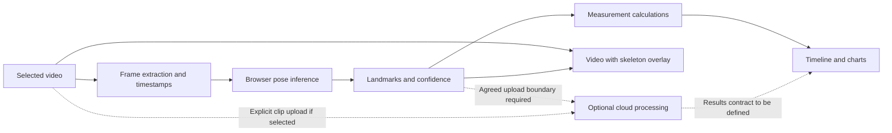

# Architecture

Status: browser analyzer implemented locally. Local execution is authorized; no cloud services have been provisioned. See [the browser-first decision](decisions/0002-browser-first-prototype.md).

## Accepted decisions

- Mobile-first web application usable in iPhone Safari without a running personal computer.
- Next.js, TypeScript and Tailwind. Vercel hosting was rejected; Cloudflare Pages is a proposal, not a provisioned or accepted deployment.
- Analyzer before AI coaching.
- Hybrid processing, with client-side MediaPipe tracking and browser-side analysis as the starting preference.
- Supabase remains optional; no database, authentication system or cloud worker has been selected.

See [the decision record](decisions/0001-hybrid-processing.md) for alternatives and tradeoffs.

## Responsibilities

The application separates browser video processing (`src/browser/analyze-video.ts` and `public/pose-worker.js`), measurement functions (`src/domain/analysis.ts`) and React presentation (`src/ui/swing-studio.tsx`). These are modules in one app, not separate services.

The dotted cloud paths are alternatives under discussion, not implemented or authorized automatic uploads. Serving the website from a static host does not require running video inference there. A cloud inference service, if needed, will require its own runtime evaluation.

The browser pipeline should retain timestamps, landmarks and confidence alongside visual output. Measurements should not depend on React components or a particular inference location. Avoid creating a generic backend abstraction before a second implementation is justified.

## Implemented validation slice

Video selection, pose extraction, overlay, scrubber, joint-angle charts, address-referenced head displacement and manual phase markers are implemented. Processing time and detection coverage are reported. Desktop visual verification is now authorized; real iPhone verification remains pending.

Preserve slow-motion timing deliberately. Model-derived coordinates and projected joint angles are estimates; do not describe them as validated 3D biomechanics or automatically reliable impact detection.

## Pending choices

| Choice | Options to discuss | Evidence needed |
| --- | --- | --- |
| Cloud input | Derived landmarks, uploaded video, or explicit fallback | On-device failures and privacy expectations |
| Frame processing tuning | Current baseline: 15 samples/s, 640-pixel frames, CPU worker | Compare accuracy, time and memory on the target device |
| Persistence beyond this prototype | Session-only with local JSON export now; browser/server history later | History requirements and retention rules |
| Cloud runtime | Select only after identifying the actual workload | Model requirements, execution time, cost and deployment limits |

For each material choice, document pros, cons, recommendation and reversibility, then record the accepted outcome before implementing dependent infrastructure.

## Data and verification

Private videos and derived personal data are not repository fixtures. Use synthetic landmarks in committed tests. Upload behavior, access controls and retention must be agreed before introducing a cloud data path. No secrets belong in client bundles or Git.

Use the [verification skill](../.agents/skills/golfswing-verification/SKILL.md). A desktop test or successful build is not evidence of real iPhone performance.

## Recovered analyzer context

The original discussion prioritized timestamped raw landmarks, projected joint angles, head displacement and manually selected phases before AI coaching. The browser app preserves those landmarks in JSON; no new inference is needed to compute head displacement. Camera-specific recording guidance is shown in the interface.

Head displacement uses the nose landmark relative to the nearest sample at the manual address marker. Pixel-space displacement is divided by video height and shown as a percentage, not centimetres or a quality judgment. Missing or uncertain reference/current landmarks remain unavailable. Head rotation and camera motion influence this proxy. True 3D rotation, club tracking, automatic impact detection, annotated-video export and swing comparison remain later work, not implemented features.

## Analysis workbench interface

The user superseded the initial consumer coaching-tool visual direction with an engineering workbench, based on Jeremy Park's basketball visualization in https://github.com/jeremyipark/vision-demos. Use compact dark panels, prominent annotated video, color-coded body sides, signal plots and inspectable raw landmarks. No slogans, product onboarding or illustrative fake data. This changes presentation, not the accepted browser-first processing architecture. No source code or assets from that reference were copied.
