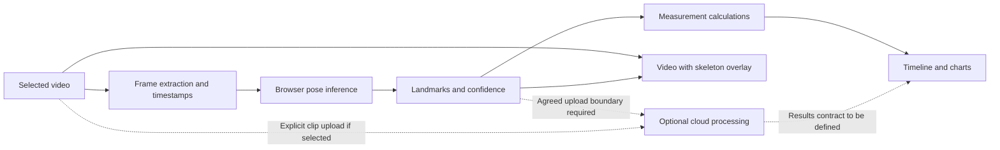

# Architecture

Status: agreed product direction with proposed implementation boundaries. No application or cloud services have been implemented yet.

## Accepted decisions

- Mobile-first web application usable in iPhone Safari without a running personal computer.
- Next.js, TypeScript and Tailwind, with Vercel as the intended web host.
- Analyzer before AI coaching.
- Hybrid processing, with client-side MediaPipe tracking and browser-side analysis as the starting preference.
- Supabase remains optional; no database, authentication system or cloud worker has been selected.

See [the decision record](decisions/0001-hybrid-processing.md) for alternatives and tradeoffs.

## Proposed responsibilities

Keep these responsibilities separable in code; they are not a commitment to separate services or packages.

The dotted cloud paths are alternatives under discussion, not implemented or authorized automatic uploads. Serving the website from Vercel does not require running video inference there. A cloud inference service, if needed, will require its own runtime evaluation.

The browser pipeline should retain timestamps, landmarks and confidence alongside visual output. Measurements should not depend on React components or a particular inference location. Avoid creating a generic backend abstraction before a second implementation is justified.

## First validation slice

Select a short video, extract poses and render an overlay. Measure processing time, UI responsiveness, cancellation and tracking failures on a real iPhone. Then introduce a scrubber, camera-appropriate measurements and manual swing-phase markers.

Preserve slow-motion timing deliberately. Model-derived coordinates and projected joint angles are estimates; do not describe them as validated 3D biomechanics or automatically reliable impact detection.

## Pending choices

| Choice | Options to discuss | Evidence needed |
| --- | --- | --- |
| Cloud input | Derived landmarks, uploaded video, or explicit fallback | On-device failures and privacy expectations |
| Frame processing | Sampling rate, inference resolution, worker execution | Accuracy versus time and memory on the target device |
| Persistence | Session only, browser storage, server storage | History/export requirements and retention rules |
| Cloud runtime | Select only after identifying the actual workload | Model requirements, execution time, cost and deployment limits |

For each material choice, document pros, cons, recommendation and reversibility, then record the accepted outcome before implementing dependent infrastructure.

## Data and verification

Private videos and derived personal data are not repository fixtures. Use synthetic landmarks in committed tests. Upload behavior, access controls and retention must be agreed before introducing a cloud data path. No secrets belong in client bundles or Git.

Use the [verification skill](../.agents/skills/golfswing-verification/SKILL.md). A desktop test or successful build is not evidence of real iPhone performance.
